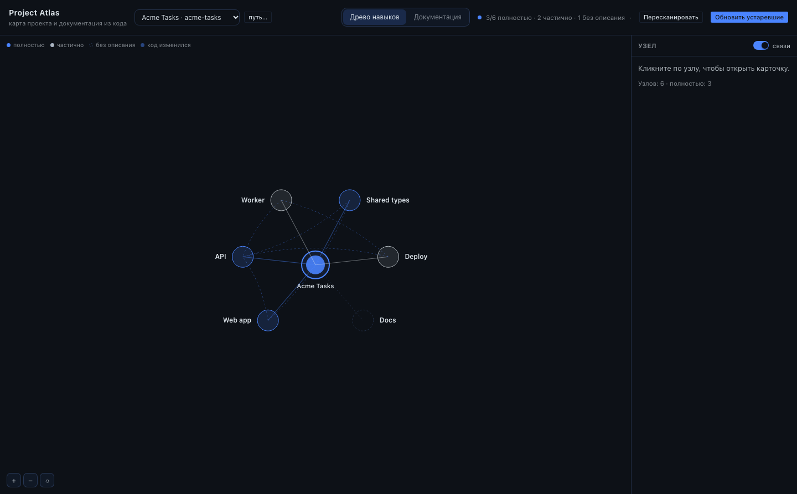
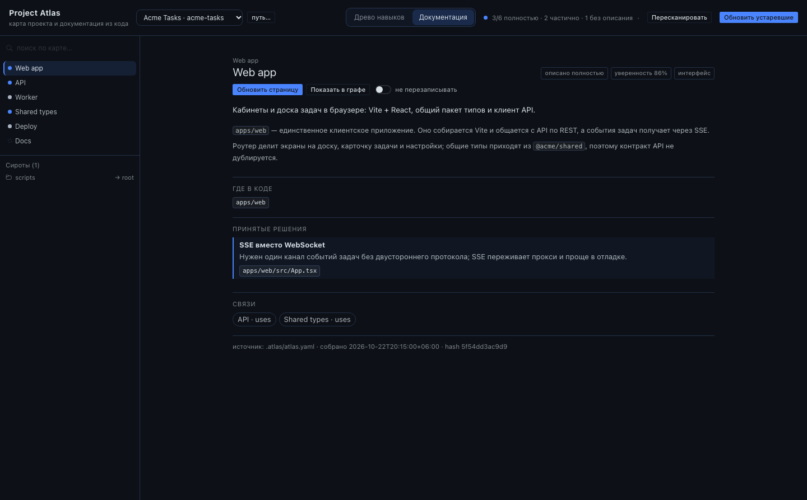

# Project Atlas

A Hermes plugin that turns **any** repository into two things:

- a **skill tree** of the project's parts, in the left sidebar next to Kanban;
- a **documentation tab** whose pages are derived from the same single file.

The only stored artifact is `<project>/.atlas/atlas.yaml`. There are no page files
to get stale: delete everything except that YAML and the renderer still works.





> The screenshot above is a **demo** render of a synthetic project (Acme Tasks),
> not a customer repository. It is produced by the same page component and the
> app's own SDK/theme tokens.

## What it does

```
repository → [1 scanner] → facts.json → [2 agent] → atlas.yaml → [3 renderer]
```

1. **Scanner** — ordinary Python, no model. Manifests, entrypoints, compose
   services, routes, README/ADR, TODOs, commits. Writes `.atlas/facts.json`.
   Skips `.env`, keys, binaries, `node_modules`, virtualenvs and `.gitignore`'d
   files.
2. **Agent** — one structured model call per node. It reads a bounded evidence
   slice (code, README, ADR, commits touching the node's paths) and returns
   summary, overview, decisions with evidence, links and open questions. The
   branch list comes from the facts, not from a built-in template: a CLI gets
   1–2 branches, a monorepo gets one per package/service.
3. **Renderer** — knows nothing about the project. It reads `atlas.yaml` and
   draws the radial tree and the documentation page. The desktop half talks to
   `dashboard/plugin_api.py`, which calls the same `atlas_core` code.

## Requirements

- Hermes Agent `>= 0.21.5` with the desktop app for the UI (the CLI and tools work
  without it).
- The model call uses **your active Hermes provider/model**; no keys are stored by
  the plugin.
- `ruamel.yaml` (declared in `pyproject.toml`; Hermes already ships it).

## Install

```bash
hermes plugins install raimbaev223/project-atlas
hermes plugins enable atlas
```

For a reproducible install, pin the commit:

```bash
hermes plugins install raimbaev223/project-atlas --ref ff6b422e001d51f75f87e5dc33bcd3734c17219c
```

With a named profile, add `-p <profile>` to both commands. The desktop half is
copied from the installed package into `~/.hermes/desktop-plugins/atlas/` by the
app on its next scan (or **Capabilities → Plugins → Rescan**).

Then enable the UI half once:

1. **Settings → Plugins** (or **Capabilities → Plugins**) → find **atlas** →
   turn on the **Desktop** toggle.
2. If you do not see the row yet: `⌘K` → **Reload desktop plugins**.

A **Project Atlas** row appears in the left sidebar, under Kanban.

One-click install link:

```html
<a href="hermes://plugin/install?repo=raimbaev223/project-atlas&enable=1">Install in Hermes</a>
```

## First map

1. Click **Project Atlas** in the sidebar.
2. Pick a project (or paste an absolute path with **путь…**).
3. **Построить карту** — the plan panel shows nodes, files, KB, approximate input
   tokens and model calls. Nothing is generated until you press **Запустить**.
4. When the build finishes, the graph shows coverage and the Documentation tab is
   filled. Stale nodes are marked after the next scan.

From chat, the same thing:

```text
/atlas scan /abs/path
/atlas plan /abs/path --scope all
/atlas build /abs/path --scope all --yes <hash>
```

Or ask the agent to use `atlas_scan`, `atlas_plan`, `atlas_build`, `atlas_status`.

## Files in the project

| Path | Purpose | Commit? |
|---|---|---|
| `.atlas/atlas.yaml` | the map — human-readable, diff-friendly | yes |
| `.atlas/changelog.md` | what each run changed and why | yes |
| `.atlas/facts.json` | scanner evidence; safe to delete | no |
| `.atlas/cache/hashes.json` | per-file hash cache | no |
| `.atlas/jobs/last.json` | last build status | no |

Suggested `.gitignore` if you want the map in git:

```gitignore
.atlas/facts.json
.atlas/cache/
.atlas/jobs/
```

## Scopes and updates

- `stale` (default) — only nodes whose `sourceHash` changed, plus undescribed ones.
- `node:<id>` — that node and its direct neighbours (parent/children).
- `undescribed` — nodes with `status: none`.
- `all` — every node; requires the plan hash as confirmation.

`locked: true` nodes are never rewritten. If their code moved, the builder adds a
`todo` note and leaves the text alone. Manual edits to an unlocked node survive as
long as they are outside the fields the builder owns (`summary`, `overview`,
`status`, `confidence`, `kind`, `decisions`, `links`, `todo`, `sourceHash`); a
hand-written name, parent or path list is not changed.

Orphan folders are listed in the Documentation sidebar with a suggested parent;
they are not silently attached.

## Status semantics

- **full** — the page is confirmed by code.
- **partial** — part of it is inferred; see `todo`.
- **none** — code was found but not described yet.

`confidence` is the model's own estimate, not a quality guarantee.

## Safety

- The project's code is **read-only** for Atlas. The only writes are under
  `.atlas/` — enforced in code, not by convention.
- `.env`, private keys, credential-looking names and ignored directories are
  skipped by name and by a binary sniff; evidence is redacted for token-shaped
  strings before it reaches a prompt.
- The model sees bounded excerpts, never whole repositories.
- The plugin runs in-process with the same permissions as any Hermes plugin.
  Capabilities are consent, not a sandbox — review plugin code you install.

## Development

```bash
python -m unittest discover -s tests -v      # 10 deterministic tests, no model
python -m atlas_core.cli scan -p ~/some/repo
python -m atlas_core.cli draft -p ~/some/repo
hermes atlas build -p ~/some/repo --scope node:core   # uses ctx.llm
```

`atlas_core` has no Hermes imports except the `ctx.llm.complete_structured`
adapter in `tools.py` / `dashboard/plugin_api.py`, so the scanner, schema,
merger and renderer can be tested from a plain Python process.

Layout:

```
plugin.yaml               agent manifest (tools, slash command, CLI, skill)
__init__.py               register(ctx)
tools.py                  atlas_scan / atlas_plan / atlas_build / atlas_status
schemas.py                tool schemas
atlas_core/
  schema.json             JSON Schema for atlas.yaml
  facts.py                deterministic scanner
  structure.py            facts → draft branches; orphan suggestions
  build.py                plan, evidence, model calls, merge, changelog
  model.py                YAML round-trip, validation, hashing, coverage
  render.py               read-only projections (tree text, pages, stale)
  jobs.py                 in-process build jobs for the desktop backend
  cli.py                  standalone scan/draft/plan/build/tree/validate
dashboard/plugin_api.py   /api/plugins/atlas/*
desktop/plugin.js         sidebar row, tree, docs, plan panel
skills/atlas/SKILL.md     procedure for the agent
tests/test_atlas.py       10 tests, no network
```

## Known limits

- One model call per node, so a large map is not instant; the plan shows the
  count and token estimate before you commit.
- Cross-links are proposed by the model and validated against real node ids; they
  are not a full import graph yet.
- The scanner is deliberately conservative: if it cannot read a file safely, it
  is counted but not parsed.
- No background daemon. A build lives in the gateway process; a restart loses live
  progress, while everything already written stays in `atlas.yaml` and the
  changelog.

## License

MIT.
